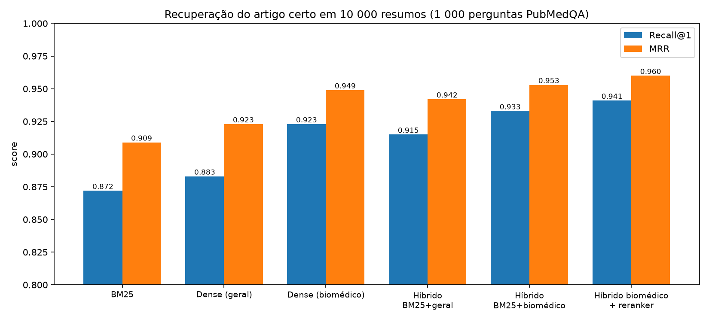
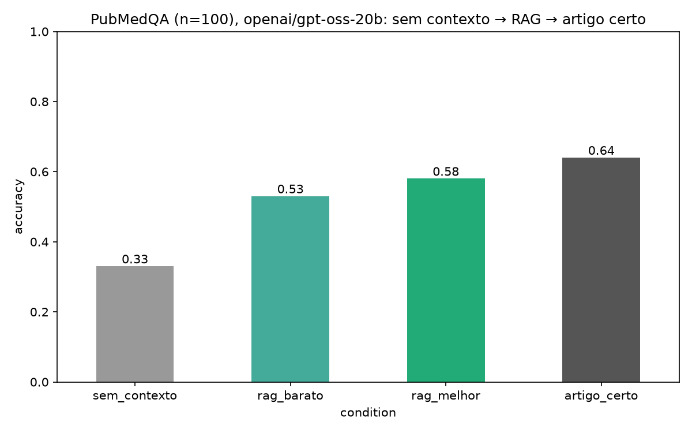

# OncoRAG

**Can a retrieval system find the right paper among thousands, and how much of the "perfect context" accuracy does it keep?**

A follow-up to [LLM Bench Oncology](https://github.com/), which showed that giving `gpt-oss-20b` the correct abstract nearly doubles its accuracy on PubMedQA (34% → 66%). That setup assumed *perfect retrieval*. OncoRAG removes the assumption: the system has to **find** the abstract itself in a corpus of 10,000, and the full pipeline is evaluated end to end.

```
Question ─► Retrieval (BM25 / dense / hybrid) ─► top-20 ─► Cross-encoder reranking ─► top-3 ─► LLM ─► yes / no / maybe
```

## Setup

- **Corpus:** 10,000 PubMed abstracts: the 1,000 expert-labelled PubMedQA abstracts plus 9,000 unlabelled PubMedQA abstracts as distractors. Documents contain the abstract only, never the question.
- **Retrieval evaluation:** 1,000 questions, each with exactly one relevant abstract (its `pubid`), so evaluation is fully automatic.
- **End-to-end evaluation:** the same 100 questions used in LLM Bench Oncology (seed 42), answered by `openai/gpt-oss-20b` (Groq, `temperature=0`, `reasoning_effort="low"`).

## Retrieval results (1,000 questions, 10,000 documents)

| Method | Recall@1 | Recall@5 | Recall@20 | MRR | Search time (1k queries, CPU) |
|---|---|---|---|---|---|
| BM25 | 0.872 | 0.956 | 0.976 | 0.909 | 0.3 s |
| Dense, general (`all-MiniLM-L6-v2`) | 0.883 | 0.972 | 0.986 | 0.923 | 3–5 s |
| Dense, biomedical (`pubmedbert-base-embeddings`) | 0.923 | 0.979 | **0.992** | 0.949 | 15–25 s |
| Hybrid RRF: BM25 + general | 0.915 | 0.974 | 0.986 | 0.942 | 3–6 s |
| Hybrid RRF: BM25 + biomedical | 0.933 | 0.977 | 0.989 | 0.953 | 15–25 s |
| **Hybrid biomedical + reranker** (`ms-marco-MiniLM-L-6-v2`, top-20) | **0.941** | **0.982** | 0.989 | **0.960** | ~15 min |



Indexing cost on CPU: 7 min for the general model, 37 min for the biomedical model (10,000 abstracts).

## End-to-end RAG results (100 questions, gpt-oss-20b)

| Condition | Context given to the LLM | Gold abstract in context | Accuracy |
|---|---|---|---|
| No context | Question only | — | 0.33 |
| RAG, cheap | Top-3 from hybrid BM25 + general | 94% | 0.53 |
| **RAG, best** | Top-3 from hybrid biomedical + reranker | 96% | **0.58** |
| Gold abstract | The correct abstract only (perfect retrieval) | 100% | 0.64 |



The "no context" and "gold abstract" conditions reproduce LLM Bench Oncology (34% and 66%) within noise, which confirms the setup is consistent across projects.

## Findings

1. **Domain-specific embeddings pay off.** The biomedical model beats the general one by 4 points of Recall@1 (92.3% vs 88.3%) and BM25 by 5 points.
2. **Lexical and semantic search fail on different questions.** Only BM25 ranks the gold abstract first in 35 questions, and only the biomedical model does in 86. Fusing them with RRF gives the best first-stage retriever (93.3%).
3. **A cheap hybrid almost matches an expensive model.** BM25 + the small general model (91.5%) comes close to the biomedical model alone (92.3%) at about a quarter of the compute. This matters when deploying on modest hardware.
4. **The general-domain reranker helps a little, at a high cost.** It adds +0.8 Recall@1 and +0.007 MRR. On CPU, though, it is about 60× slower than the hybrid search. It only reorders candidates, so Recall@20 is unchanged by design. The gains are also not free: it demotes some correct top-1 results while promoting more.
5. **RAG recovers about 80% of the achievable gain.** The best pipeline goes from 33% to 58%, against a 64% ceiling: (58 − 33) / (64 − 33) ≈ 81%. The cheap pipeline recovers about 65%.
6. **Retrieval is no longer the main bottleneck; distractors are.** The gold abstract is in the top-3 in 96% of questions, yet accuracy is 58%, versus 64% when the model sees only the gold abstract. The two extra, topically similar abstracts cost about 6 points. Better reranking, fewer passages or instructing the model to cite its source are the natural next steps.

## Limitations

- **Easy queries for retrieval.** PubMedQA questions are derived from paper titles, so they share rare technical terms with their abstracts. Real user questions would make retrieval harder, especially for BM25.
- **Small corpus.** 10,000 abstracts is far from PubMed's 35M+, so absolute recall numbers are optimistic.
- **Possible contamination.** The biomedical embedding model was trained on PubMed text that may overlap with these abstracts.
- **n = 100 for the end-to-end test.** Each accuracy has roughly ±10 points of uncertainty. The ordering of conditions is consistent, but the 5-point gap between the cheap and the best RAG pipeline is not statistically conclusive.
- **Reranker not in the domain.** A biomedical cross-encoder, or a GPU, could change the cost/benefit conclusion.
- **API quotas.** The free tier's daily token limit interrupted the first end-to-end run. Failed calls were retried separately with `rag_retry.py`, with identical prompts and settings, and the final results have 0 errors.

## Repository

```
build_corpus.py     # builds the 10k-document corpus and the 1k questions
retrievers.py       # reusable retrieval module: BM25, Dense, Hybrid (RRF), Rerank (same search() interface)
evaluate.py         # Recall@k and MRR for every method, plus complementarity analysis
plot_results.py     # retrieval chart
rag.py              # end-to-end RAG evaluation (4 conditions)
rag_retry.py        # retries only the rows that failed due to API rate limits
results/            # CSV outputs and charts
```

`retrievers.py` exposes one interface, `search(queries, k)`, for every method, so it can be reused as a tool by an agent.

## How to run

```bash
python -m venv .venv
.venv\Scripts\activate          # Windows  (macOS/Linux: source .venv/bin/activate)
pip install -r requirements.txt
echo GROQ_API_KEY=your_key > .env
python build_corpus.py          # ~2 min
python evaluate.py              # first run computes embeddings (~45 min on CPU), later runs use the cache
python plot_results.py
python rag.py                   # end-to-end, needs the Groq key
```

## Stack

Hugging Face `datasets` and `sentence-transformers` (bi-encoders and cross-encoder) · `bm25s` · NumPy · OpenAI-compatible client (Groq) · pandas · matplotlib